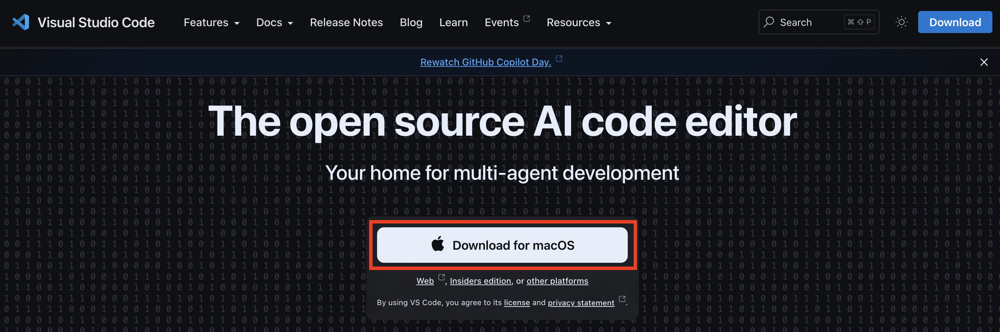

# Coding 101

## Setup

### Create a Github Account or Sign In 
1. Visit [github.com](https://github.com/)
2. Sign in to GitHub. If you DON'T have a GitHub account already:
    * Click `Sign Up` and create one
    * DO NOT use your @iu.edu email when signing up. Use a personal email that you have access to.
3. 

### Install Visual Studio Code ("VS Code")
1. Visit https://code.visualstudio.com/
2. Click the download button: 
3. Open VS Code
4. If asked, click `Sign in with GitHub` and sign in with your GitHub Account

##  Install Codex or Claude Code for VS Code (for IDE)
1. Install either Codex or Claude Code:
    * Everyone at IU has access to Codex. [Install Codex for VS Code here](vscode:extension/openai.chatgpt)
    * If you pay for a personal Claude subscription, you could instead [install Claude Code for VS Code here](vscode:extension/anthropic.claude-code)

2. 

