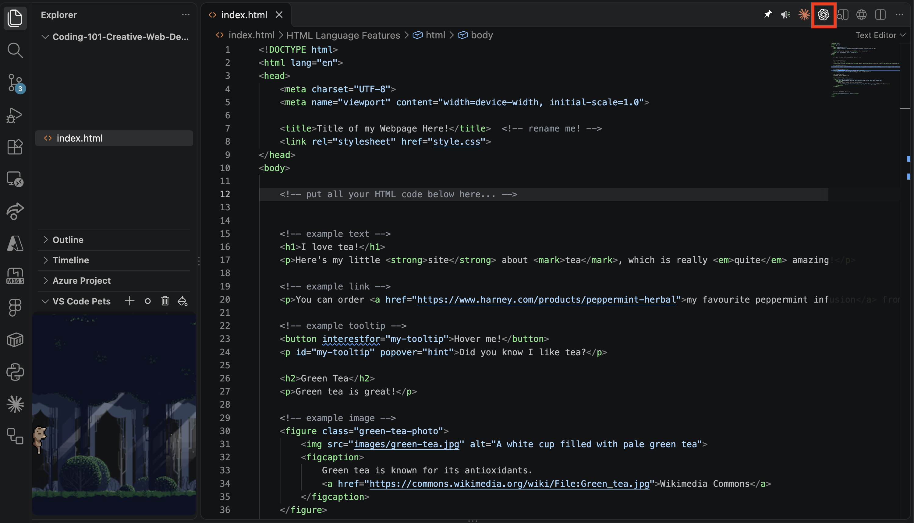

import { FileTree, Steps, LinkButton } from '@astrojs/starlight/components';

<Steps><ol>

  <li>
    ## Click Sign In
    Click `Sign in with ChatGPT`
    

    
    

      
  </li>

  <li>
    ## Sign in with your `@iu.edu` Email
    Enter your `@iu.edu` email or select your account if you're already signed in.

    

      
    

     
  </li>

  <li>
    ## Install Codex or Claude Code
    Codex (by OpenAI) and Claude Code (by Anthropic) connect AI models to your code so you can use right within VS Code... no copy/pasting needed!

    If you are affiliated with IU, _**you get Codex for free!**_

    <LinkButton target="blank" href="vscode:extension/openai.chatgpt">Install Codex</LinkButton>
      

    Click Install:
    
    

    (These steps work the same for paying subscribers of Claude Code, but we won't use that today.)
    
  </li>

    <li>
    ## Open `index.html` and Click Codex Icon
    Open your `index.html` file and click the Codex/OpenAI icon in the upper right:

    
    
  </li>

</ol></Steps>

