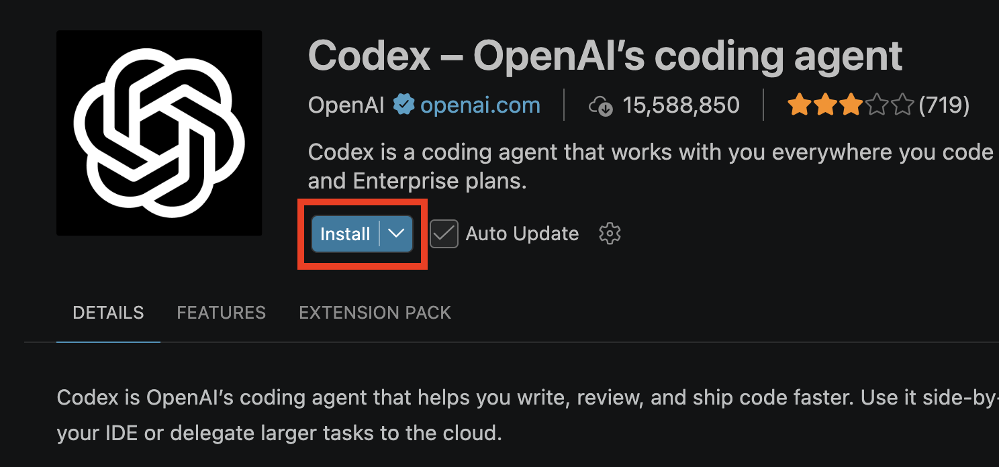

import { FileTree, Steps, LinkButton } from '@astrojs/starlight/components';

<Steps><ol>

  <li>
    ## Download and Install VS Code
    We use Visual Studio Code ("VS Code") to write code. Think of it like a fancy Notepad or TextEdit. Install VS Code on your machine to get started.

    <LinkButton target="blank" href="https://code.visualstudio.com/download" icon="vscode" iconPlacement="start">Download VS Code</LinkButton>

      
  </li>

  <li>
    ## Open VS Code
    Once it installs, go ahead and open VS Code.

    _**IMPORTANT:**_ Be sure to close the tab that you used to download VS Code.
      
     
  </li>

  <li>
    ## Install Codex or Claude Code
    Codex (by OpenAI) and Claude Code (by Anthropic) connect AI models to your code so you can use right within VS Code... no copy/pasting needed!

    If you are affiliated with IU, _**you get Codex for free!**_

    <LinkButton target="blank" href="vscode:extension/openai.chatgpt">Install Codex</LinkButton>
      

    Click Install:
    
    

    (These steps work the same for paying subscribers of Claude Code, but we won't use that today.)
    
  </li>

</ol></Steps>

