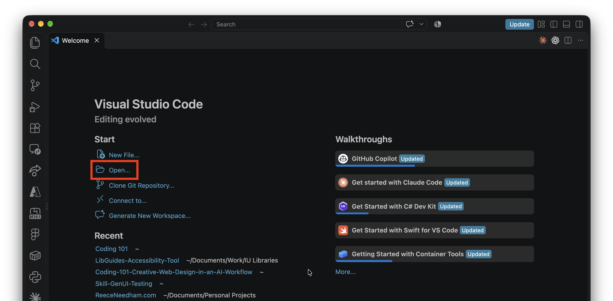
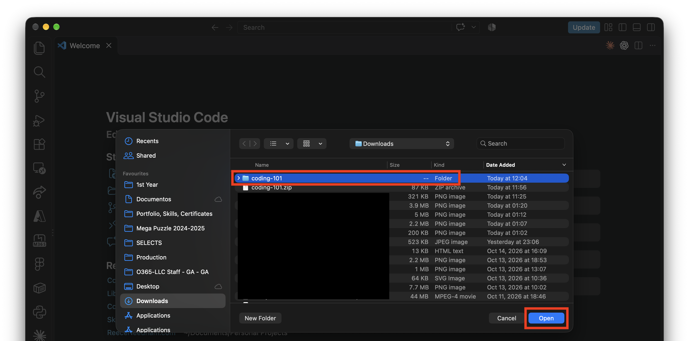
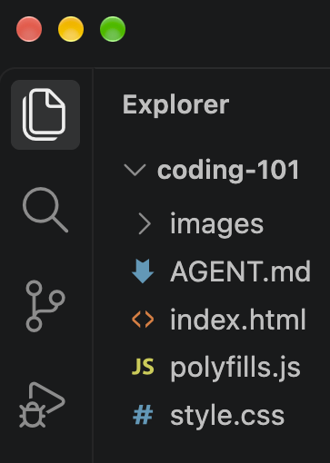

import { FileTree, Steps, LinkButton } from '@astrojs/starlight/components';

<Steps><ol>

  <li>
    ## Download the files for today

    <LinkButton download href="/coding-101.zip" icon="download" iconPlacement="start">Download Files</LinkButton>
     
  </li>

  <li>
    ## Unzip/Extract the files
    On macOS, double click the `coding-101.zip` file to unzip it.   
    On Windows, right click `coding-101.zip` > `Extract` to unzip it.   
     
  </li>

  <li>

    ## Open the Folder in VS Code

    In VS Code, click `Open` then click the `coding-101` folder.

      
      

     
  </li>

  <li>
    ## Files You'll See
    Finally, VS Code should show these files:

    
      <FileTree>

      - coding-101
        - AGENT.md project instructions we give to codex
        - index.html where we'll add elements to our page
        - polyfills.js ignore this one lol
        - style.css where we'll make things look *pretty*
        - images/ we'll put images/videos/etc. in here
      </FileTree>

      
    
  </li>

</ol></Steps>

