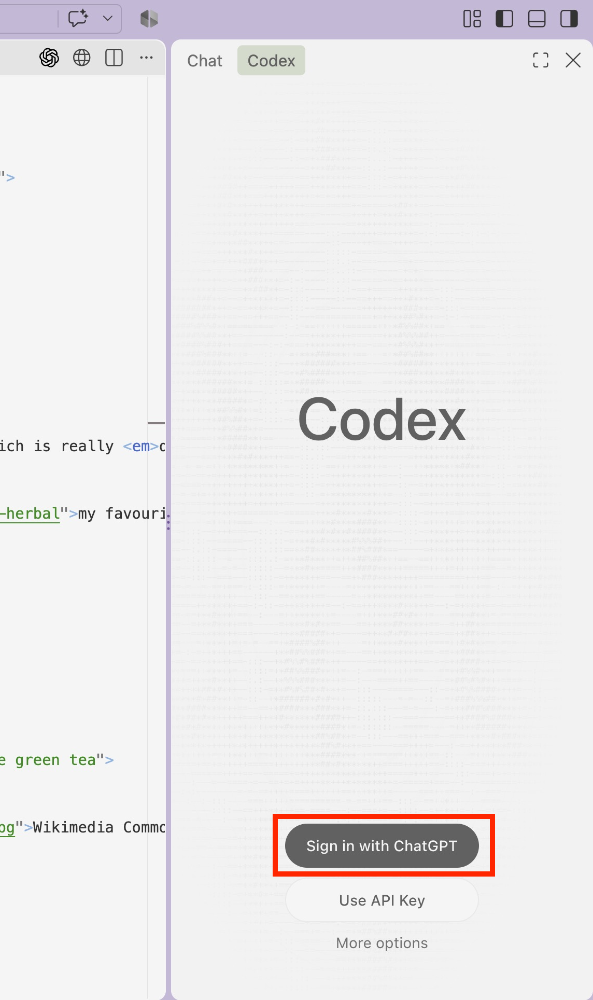

import { FileTree, Steps, LinkButton } from '@astrojs/starlight/components';

<Steps><ol>

  <li>
    ## Click Sign In
    Click `Sign in with ChatGPT`
    

    
    

      
  </li>

  <li>
    ## Sign in with your `@iu.edu` Email
    Enter your `@iu.edu` email or select your account if you're already signed in.

    

      
    

  </li>

    <li>
    ## Approve Sign In
    Select the `Indiana University ChatGPT Edu` workspace

    

      
    

  </li>

  <li>
    ## Authorise Workspace
    Click `Approve sign-in`

    

      
    

  </li>

  <li>
    ## Done!
  </li>

</ol></Steps>

