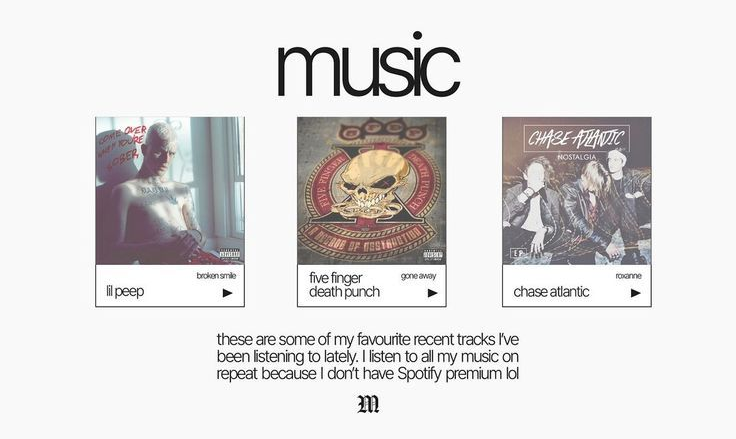
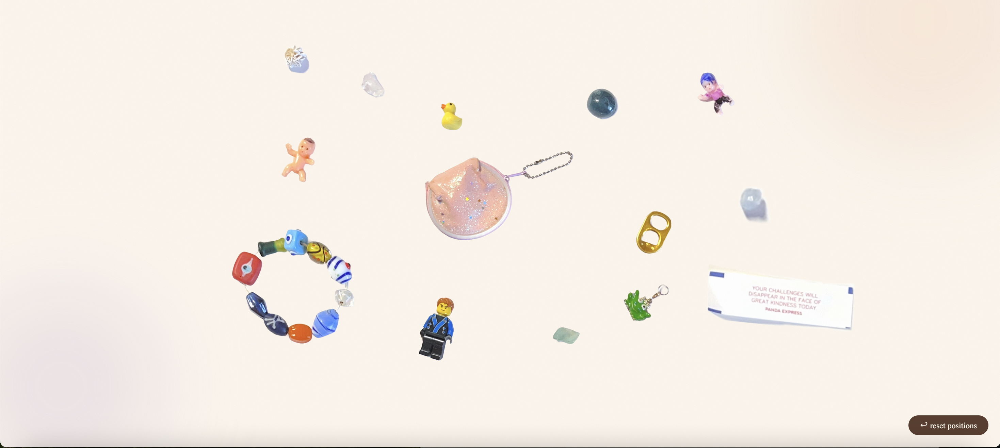
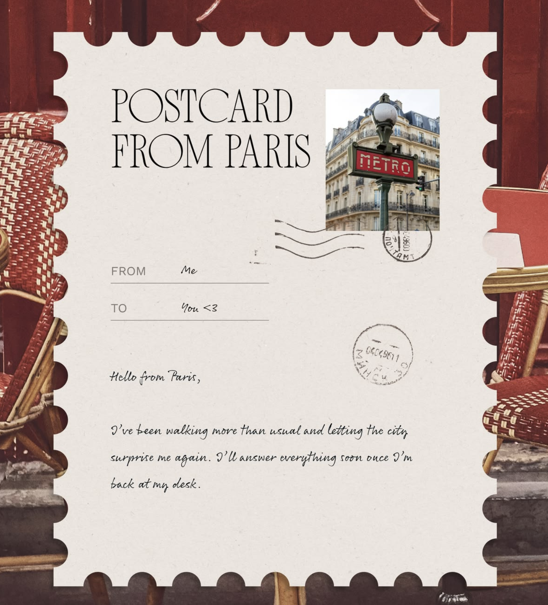
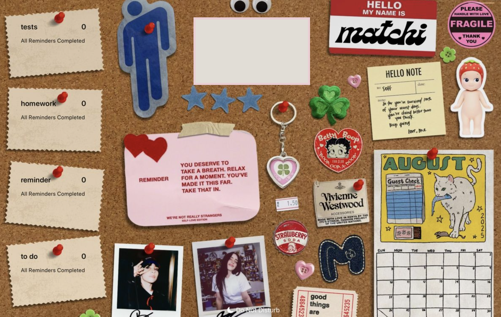
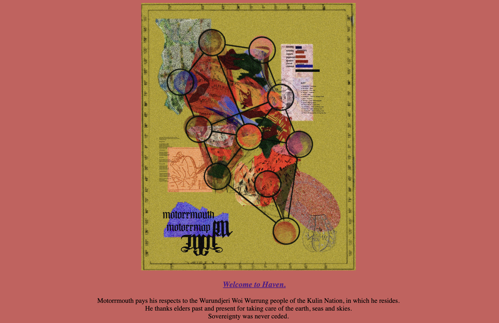

## Agenda
1. Welcome
2. Install software 
3. Coding Basics
4. Use AI to enhance your creation
5. Share with the class (if u want to :3)

## What will we learn?
This is just the jumping off point! We want to give you enough skills to allow to leave and explore more on your own. So that means leaving today with:
1. A basic understanding of HTML and CSS
2. How to connect and use AI (LLM) with your code
3. Some good practices to help you along

## What will we be build?
Idk! You get creative! You can create things like:
    - A personal page
    - A scrapbook page / time capsule / mood board
    - A social-commentary piece / informative rant

### Some loose rules
1. Should be a webpage (lol)
1. Make it about something you're interested in
2. Must be all on one page
3. Think of it like a scrapbook, time capsule, or other _**static**_ collection (so not something like a game or database that requires getting data from elsewhere)
  * think dumb 1990s website
  * just static photos/videos, nothing fancy
  * not a game
  * no forms
  * not a live data collection/databases

4. Be creative... and have fun with it! (no lame corporate buzzwords pls!)

### Examples

#### A showcase of one's favorite music:

#### A showcase of one's beloved trinkets:

#### A postcard/stamp to a place you like:

#### A bulletin board / mood board:

#### An homage to your land's indigenous peoples:

...

or any other fun idea that you have!

