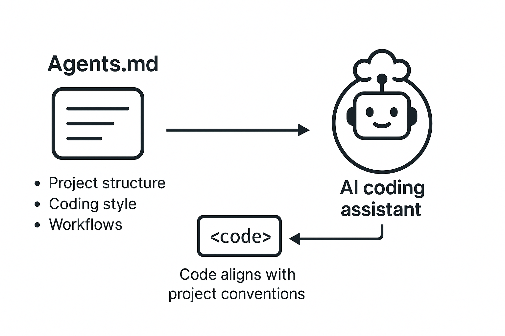

import { FileTree, Steps, LinkButton } from '@astrojs/starlight/components';

## `index.html`
index.html is a file written in the coding language HTML. It is the skeleton and structure for your webpage.

**For example:* Putting a `<button>` on your page

## `style.css`
style.css is a file written in the coding language CSS. It makes your webpage pretty. 

**For example:* Giving your `button { color: green }` text.

## `AGENTS.md`

Just how you tell a collaborator what your project is about, we will be doing the same thing with your AI agent using an AGENTS.md file. 
AGENTS.md file outline rules and boundaries for your AI agent and gives it context of your project. 
Your AGENTS.md file should
* States a clear role: Define the main goal, who the agent is (ex: UX designer), what skills it has (ex: HTML, CSS), and what it does (ex: read code, write code)
* Project knowledge: coding languages it is allowed to use, access to your files
* Boundaries: set rules of what it can/cannot do to prevent it from making mistakes or doing random things
