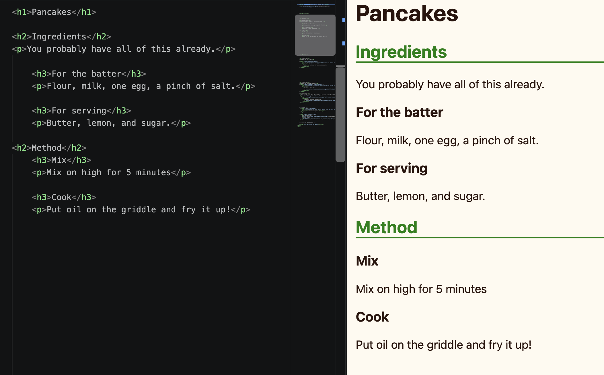

import { Code } from "astro-expressive-code/components"


## Snippet
```html
<!-- index.html -->
<h1>...</h1>
<h2>...</h2>
<h3>...</h3>
<h4>...</h4>
<h5>...</h5>
<h6>...</h6>
```
* Heading text that represents the title of a section
* The "number" corresponds to the "level" of the heading (e.g. `<h2>` is a subheading to a section with an `<h1>`, etc.)

## Example



```html
<!-- index.html -->
<h1>Pancakes</h1>

   <h2>Ingredients</h2>
   <p>You probably have all of this already.</p>

      <h3>For the batter</h3>
      <p>Flour, milk, one egg, a pinch of salt.</p>

      <h3>For serving</h3>
      <p>Butter, lemon, and sugar.</p>

   <h2>Method</h2>

      <h3>Mix</h3>
      <p>Mix on high for 5 minutes</p>

      <h3>Cook</h3>
      <p>Put oil on the griddle and fry it up!</p>
```
```css
/* style.css */
h1, h2, h3, h4, h5, h6 {
   color: black;
}

h2 {
   color: green;
   border-bottom: solid green 2px;
}
```
(We wouldn't recommend trying to make this recipe at home.)