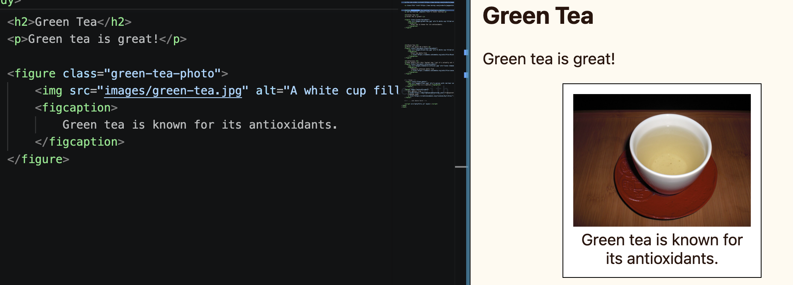

import { Code } from "astro-expressive-code/components"


## Snippet
```html
<!-- index.html -->
<figure class="...">
    
    <figcaption>
        ...
    </figcaption>
</figure>
```
* Put your image in the `images` folder, then enter the file name of the image in `src`, for example: `src="images/my-fun-image.png"`
* Give your figure a class name in `class="..."`
* Descriptively write what is in your image in `alt="..."`
* (Optionally) Write a caption in `<figcaption>`

## Example



```html
<!-- index.html -->
<figure class="green-tea-photo">
    
    <figcaption>
        Green tea is known for its antioxidants.
    </figcaption>
</figure>
```
```css
/* style.css */
.green-tea-photo {
    width: 200px;
    border: solid black 1px;
    margin: 0 auto;
    padding: 10px;
    background-color: white;
    text-align: center;
}

.green-tea-photo > img {
    max-width: 100%;
    height: auto;
    border-style: none;
}
```