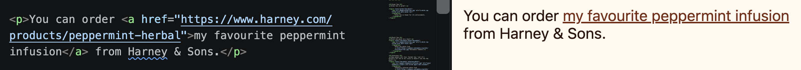

import { Code } from "astro-expressive-code/components"


## Snippet
```html
<!-- index.html -->
<a href="...">...</a>
```
* Put the URL you want to visit in `href="..."`
* Put the text to show on the screen in between the `<a>` tags

## Example



```html
<!-- index.html -->
<p>You can order <a href="https://www.harney.com/products/peppermint-herbal">my favourite peppermint infusion</a> from Harney & Sons.</p>
```
```css
/* style.css */
a {
   color: rgb(120, 44, 20);
}
```
(We wouldn't recommend trying to make this recipe at home.)