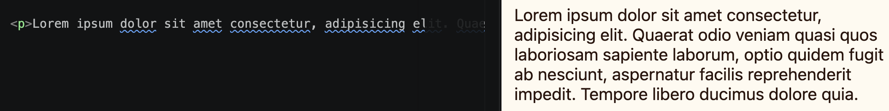

import { Code } from "astro-expressive-code/components"


## Snippet
```html
<!-- index.html -->
<p>...</p>
```
* Just some text!

## Example



```html
<!-- index.html -->
<p>This is some paragraph/body text.</p>
```
```css
/* style.css */
p {
   color: black;
}
```