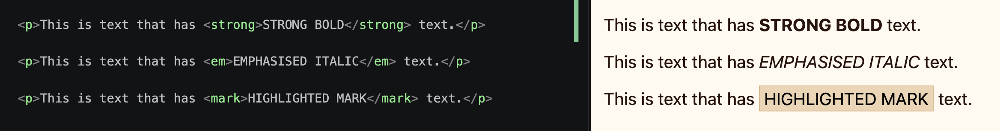

import { Code } from "astro-expressive-code/components"


## Snippet
```html
<!-- index.html -->

<p>This is text that has <strong>STRONG BOLD</strong> text.</p>

<p>This is text that has <em>EMPHASISED ITALIC</em> text.</p>

<p>This is text that has <mark>HIGHLIGHTED MARK</mark> text.</p>

```
* `<strong>`, `<em>`, `<mark>` and others can live within an existing `<p>` or other text!!

