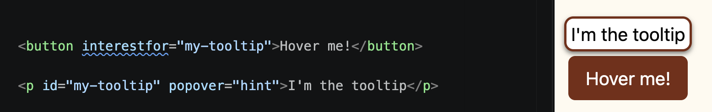

import { Code } from "astro-expressive-code/components"


## Snippet
```html
<!-- index.html -->
<button interestfor="***">Hover me!</button>

<p id="***" popover="hint">I'm the tooltip</p>
```
* Give your tool tip an `id="..."` and put that _same_ `id` for `interestfor="..."` on the thing you need to hover
* `interestfor` works for `<button>` or `<a>` tags. (You'll mostly be using `<button>` tho)

## Example



```html
<!-- index.html -->
<button interestfor="my-tooltip">Hover me!</button>
<p id="my-tooltip" popover="hint">I'm the tooltip</p>
```
```css
/* style.css */
[popover='hint'] {
    position-area: top;
    position-try-fallbacks: flip-block;
    margin: 4px;
    background-color: white;
    padding: 4px;
    border: 2px solid var(--primary-color);
    border-radius: 8px;
    box-shadow: 0 2px 4px 0 rgba(0, 0, 0, 0.5);
    transition: opacity 0.1s, translate 0.1s;
    transition-behavior: allow-discrete;

    @starting-style {
        opacity: 0;
        translate: 0 50% 16px;
    }
}
```